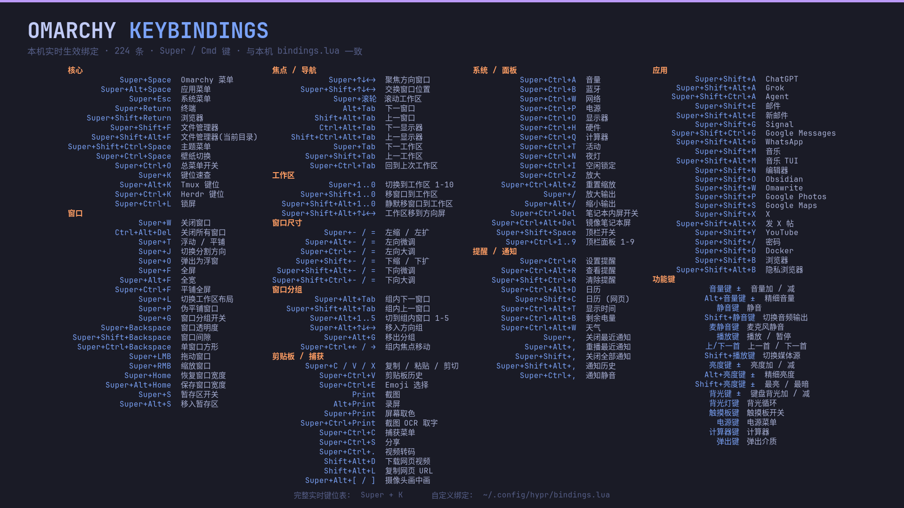

# omarchy-keybindings-wallpaper

为 Omarchy 生成一张 **1920×1080 快捷键壁纸**（Tokyo Night 配色），数据来源是
本机 `omarchy menu keybindings --print` 的**实时生效绑定**，而非网上的通用速查表。

[](docs/preview.png)

> 上图为在本机生成的示例，点击可查看 1920×1080 原图（GitHub 页面内显示的是缩放后的版本）。
> 你生成的实际内容取决于你自己的实时绑定。

## 用法

```bash
./keybindings-wallpaper.py             # 生成到 ./dist/keybindings-wallpaper.png
./keybindings-wallpaper.py --install   # 生成并安装为当前主题的壁纸且立即应用
./keybindings-wallpaper.py --output /tmp/x.png
```

`--install` 会执行：

1. 把 PNG 复制到 `~/.config/omarchy/backgrounds/<当前主题>/`
2. 运行 `omarchy theme bg set` 立即应用

## 依赖

- `pango`（`pango-view`，带 Pango 标记渲染）
- `imagemagick`（合成画布与文字）
- 中文字体（Noto Sans CJK，`fontconfig-noto`），否则中文标签会显示为豆腐块

检查：

```bash
command -v pango-view magick identify
fc-list :lang=zh | grep -qi noto
```

## 特性

- **逐条校验**：壁纸上 216 条精选键位，全部与 `omarchy menu keybindings --print`
  实时比对，缺失/写错的会在 stderr 报警（`! 实时绑定中不存在:`）。
- **折叠重复项**：工作区 1-10、分组窗口 1-5、顶栏面板 1-9、音量/亮度键等被折叠成
  一行（如 `Super+1..0`），保持壁纸可读性。
- **自动布局**：4 列均衡分组（DP 最小化最高列）、字号自动回退（13→9pt）、
  line-spacing 自适应，保证不超出画布也不重叠。
- **随系统更新**：Omarchy 升级或你改了 `~/.config/hypr/bindings.lua` 后重新跑一次即可。

## 预览图

README 顶部的 `docs/preview.png` 就是这样生成出来的。想更新它：

```bash
./keybindings-wallpaper.py --output docs/preview.png
```

脚本输出为 16-bit PNG（约 1 MB），仓库里的预览图存为 8-bit 以减小体积——浏览器
本来也只按 8-bit 显示，视觉上无差别。需要更小（约 160 KB）可再量化调色板：

```bash
magick docs/preview.png -colors 256 -strip docs/preview.png
```

## 定制

- 增删/改键位：编辑 `SHEET` 列表。条目为 `(显示键位, 中文说明, 对应的实时键列表)`，
  第三项为 `None` 时直接用第一个字段去匹配实时绑定。
- 配色：改文件开头的 `BG / KEY / LABEL / HEAD / ACCENT` 等常量。
- 分组列数：改 `NCOL`。

## 实时速查

生成后壁纸下方也写明了：

- 完整实时键位表：`Super + K`
- Tmux 键位：`Super + Alt + K`，Herdr 键位：`Super + Ctrl + K`
- 自定义绑定：`~/.config/hypr/bindings.lua`